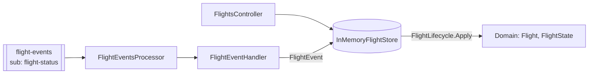

# svc-flight-status

> Keeps the current status of every flight and serves lookups and departure boards.

| | |
| --- | --- |
| Repo | `aeroflow-air/svc-flight-status` |
| Owner | AeroFlow platform (Tony Joanes) |
| Status | prototype, local only |
| Runs in | aeroflow-local AppHost resource `svc-flight-status`; Container Apps later (ADR-0007) |
| Last reviewed | 2026-10-12 |

Written to the [service docs standard](https://github.com/aeroflow-air/platform-handbook/blob/main/docs/standards/service-docs.md). The airport-wide picture is in the [airport overview](https://github.com/aeroflow-air/platform-handbook/blob/main/docs/architecture/airport-overview.md).

## Purpose

Owns the **flight record**: number, route, scheduled and estimated times, status, gate, actual times, diversion and cancellation. It enforces the lifecycle rules (boarding needs a gate, departs only from boarding, lands after departing, no events after landing or cancellation).

It does **not** decide gates (svc-gate-allocation does) and publishes nothing.

## Design decisions

| Decision | Why | Link |
| --- | --- | --- |
| Pure lifecycle: `FlightLifecycle.Apply(flight, event)` returns `Result<Flight>`; `Replay` folds events | rules testable without I/O; seed data built by replaying real events | [ADR-0004](https://github.com/aeroflow-air/platform-handbook/blob/main/docs/decisions/0004-functional-style-csharp.md) |
| Follow `flight-events` on its own subscription | decoupled from the publisher | [ADR-0013](https://github.com/aeroflow-air/platform-handbook/blob/main/docs/decisions/0013-central-event-bus.md) |
| Assign placeholder gate `TBA` on `Boarding` when no gate is known | the domain requires a gate to board, and no gate events exist yet | `Messaging/FlightEventHandler.cs` |
| Scheduled arrival = departure + 90 minutes | the simulator sends no arrival time | `FlightEvents:DefaultBlockMinutes` |
| A finished flight with the same number is replaced on `Scheduled` | simulated flight numbers repeat | `flight_already_active` otherwise |
| Business rejections completed, unreadable bodies dead-lettered | retrying cannot fix a rule violation | `Messaging/FlightEventsProcessor.cs` |
| OpenAPI via Swashbuckle, Scalar UI, Development only | [ADR-0015](https://github.com/aeroflow-air/platform-handbook/blob/main/docs/decisions/0015-api-documentation-openapi-scalar.md) | `Program.cs` |
| In-memory store seeded with demo flights (LGW, EDI, AMS, MAN, DUB) | no database until needed | `Storage/` |

## Architecture

- **Domain**: `Flight` (immutable, `Option` for unknowns), states `Scheduled`, `Delayed`, `Boarding`, `Departed`, `Landed`, `Cancelled`, `Diverted`; events `DelayAnnounced`, `GateAssigned`, `GateChanged`, `BoardingStarted`, `Departed`, `Landed`, `Cancelled`, `Diverted`; queries `DelayMinutes` and `DeparturesBoard`.
- **Messaging**: hosted processor (one message at a time, manual completion) and a handler that maps simulator events onto domain events.
- **API**: one controller over the same store.

## Inputs

### HTTP API

| Method | Route | Purpose | Responses |
| --- | --- | --- | --- |
| GET | `/health` | liveness | 200 |
| GET | `/api/flights/ping` | probe | 200 |
| GET | `/api/flights/{flightNumber}` | one flight | 200, 404 |
| GET | `/api/flights/departures/{airport}` | departures board, by estimated departure, excluding landed and diverted | 200, 400 |
| POST | `/api/flights/{flightNumber}/events` | apply a lifecycle event (`type`: `delay`, `gate-assigned`, `gate-changed`, `boarding-started`, `departed`, `landed`, `cancelled`, `diverted`) | 200, 400, 404, 409 |

Errors are `application/problem+json` with a `code` extension: 400 (`invalid_airport_code`, `invalid_gate`, `invalid_flight_number`, ...), 404 (`flight_not_found`), 409 (`invalid_transition`, `gate_required`, `gate_already_assigned`, `delay_not_later`, `landing_before_departure`, `diversion_to_destination`, `flight_already_active`). Reference docs: `/scalar` and `/openapi/v1.json` when `ApiDocs:Enabled` is true.

### Events consumed

| Topic | Subscription | Event type | Effect | Ignored |
| --- | --- | --- | --- | --- |
| `flight-events` | `flight-status` | `Scheduled` | add the flight (arrival = departure + 90 min) | nothing is filtered; all airports |
| | | `Delayed` | `DelayAnnounced` at `scheduledDeparture + delayMinutes` | |
| | | `Boarding` | assign gate `TBA` if none, then `BoardingStarted` | |
| | | `Departed`, `Landed` | `Departed` / `Landed` at `occurredAt` | |
| | | `Cancelled` | `Cancelled` with `reason` | |

Contract: `Messaging/FlightEventMessage.cs`, a **local copy** of `AeroFlow.Local.FlightEvents.FlightEvent`.

### Configuration

| Setting | Default | Meaning |
| --- | --- | --- |
| `ConnectionStrings:messaging` | unset | when unset the processor does not start |
| `FlightEvents:Topic` | `flight-events` | |
| `FlightEvents:Subscription` | `flight-status` | set by the AppHost |
| `FlightEvents:DefaultBlockMinutes` | 90 | scheduled flight time |
| `FlightEvents:PlaceholderGate` | `TBA` | gate used at boarding |
| `ApiDocs:Enabled` | false (true in Development) | Scalar and OpenAPI |

## Outputs

### Events published

None.

### Other side effects

Updates the in-memory flight store. Logs `{FlightNumber} is now {Status} after {EventType}` per applied event.

## Dependencies

| Dependency | Needed for | Behaviour when absent |
| --- | --- | --- |
| Service Bus (`messaging`), `flight-events` / `flight-status` | following the simulator | API works on demo flights; no event processing |
| flight-simulator | producing events | flights only change through the API |
| Keycloak (`identity`) | referenced by the AppHost | not used; no auth yet |

## Failure modes

| Failure | How it shows up | Impact | What to do |
| --- | --- | --- | --- |
| Event for a flight scheduled before the service started | warning `... rejected: flight_not_found` | that flight is never tracked | expected after a restart |
| Out-of-order or repeated event | warning `invalid_transition` | event ignored | none; rules make repeats safe |
| Same number scheduled while the earlier flight is still active | warning `flight_already_active` | new flight not tracked | rare; flight numbers are random |
| Unreadable or empty body | warning `Dead-lettered unreadable flight event`; dead-letter queue grows | event lost | contract copy drifted (#71) |
| Bus unreachable | warning `Service Bus processor error` repeating | no updates; SDK retries | check the emulator |
| Boarding flights show gate `TBA` | API and board | not a failure: no gate events yet | see Known gaps |
| Process restart | back to demo flights | live flights lost | expected |

Delivery is at least once; the handler is not idempotent by event id and relies on the lifecycle rules. One message at a time.

## Running and testing

- Standalone: `dotnet run --project src/AeroFlow.FlightStatus`, then `curl http://localhost:8080/api/flights/AF204` or `/api/flights/departures/LGW`; Scalar at `/scalar`.
- With the airport: clone next to `aeroflow-local` and run its AppHost. Healthy logs: `Listening for flight events on flight-events/flight-status`, then `BA1234 is now Departed after Departed`. Try `/api/flights/departures/LHR`.
- Tests: `dotnet test` covers lifecycle rules, replay, queries, value types, the API, API docs, health and the event handler.

## Known gaps

- Gate is always `TBA` for simulated flights: svc-gate-allocation publishes no gate events ([overview](https://github.com/aeroflow-air/platform-handbook/blob/main/docs/architecture/airport-overview.md#known-gaps)).
- Event contract is a local copy ([platform-handbook#71](https://github.com/aeroflow-air/platform-handbook/issues/71)).
- `workload.yaml` cannot declare the subscription ([platform-handbook#64](https://github.com/aeroflow-air/platform-handbook/issues/64)).
- Publishes no flight status events of its own; in-memory state; no authentication.
